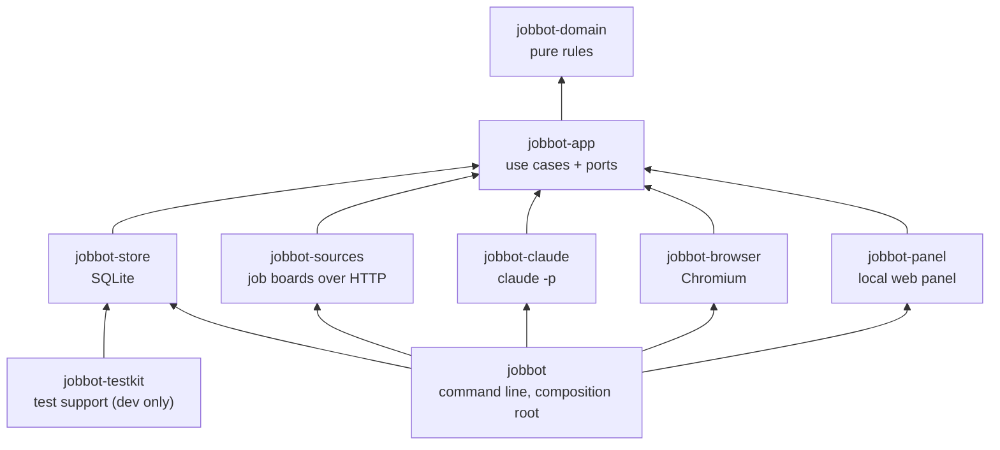

# Architecture

jobbot finds job postings, scores and filters them, prepares a CV and a dossier for each one worth
it, fills the application forms in a headless browser, and keeps the record of every application.
It is a Cargo workspace of layered crates: a pure domain at the bottom, the use cases above it, one
crate per adapter above those, and a thin command line on top. The layering is not a convention:
`tests/architecture.rs` reads `cargo metadata` and fails the build when it is broken.

The decisions behind this shape are recorded as ADRs in [`docs/adr/`](docs/adr/README.md).

## The crates

Every crate also depends on `jobbot-domain` directly; the arrows show only the layer each one
stands on.

| layer | crate | holds | may depend on |
|---|---|---|---|
| 0 | `jobbot-domain` | the job model, the application state machine, scoring, exclusion, the navigation policy, outbound-text cleaning, `Pii` and `Untrusted`, the form planner, the answer bank, the parsing of `profile/*.toml`, the execution window, the SM-2 drill scheduler | an allow-list of pure crates (`chrono`, `chrono-tz`, `html-escape`, `regex`, `scraper`, `serde`, `serde_json`, `thiserror`, `toml`, `url`; `proptest` for its tests) |
| 1 | `jobbot-app` | the use cases (discovery, the apply pipeline and its gate, the inbox import, actions, dossiers, freelance drafts, reports) and the ports they need; the privacy filter; the layout of the files (`Paths`) | the domain; never `rusqlite`, `reqwest`, `tiny_http` or `playwright-rs` |
| 2 | `jobbot-store` | the SQLite tracker (postings, applications, the event log, intents, e-mails, tasks, Claude spend, HTTP memory) and the drill store | the domain and the application |
| 2 | `jobbot-sources` | one adapter per job board or feed, the HTTP stack (rate limits, retries, cooldowns, conditional GET), the "still open" check | the domain and the application |
| 2 | `jobbot-claude` | the `claude -p` runner: arguments, child environment, account preflight, reply parsing | the domain and the application |
| 2 | `jobbot-browser` | the form filler and inspector over Playwright, the CV renderer | the domain and the application |
| 2 | `jobbot-panel` | the local web panel: HTTP guards, the snapshot, the routes, the page | the domain and the application |
| 3 | `jobbot-testkit` | fixtures, a fake Claude, the real stores in memory, the synthetic data set, the benchmark harness, the hostile corpus, the fuzz bodies | anything below; only ever a dev-dependency |
| 4 | `jobbot` | `main.rs` and `cli.rs`: parse the command, wire the adapters to the use cases, print | everything |
| 4 | `xtask` | repository chores: `cargo xtask export-public`, the scanned public copy of a commit | no workspace crate |

Crates in the same layer never depend on each other, so the database cannot call a job board and
the browser cannot call Claude: every path between two adapters goes through the application.

## Ports

The application states what it needs as traits in `crates/jobbot-app/src/ports*`; the adapters
implement them and the command line plugs them in.

| port | implemented by | used for |
|---|---|---|
| `Store` (`JobRepo`, `ApplicationRepo`, `IntentRepo`, `EmailRepo`, `TaskRepo`, `MetaRepo`, `SpendRepo`, `HistoryRepo`, `LearnRepo`, `AttemptRepo`) | `jobbot-store` | everything that is remembered |
| `HttpMemory` | `jobbot-store` | cooldowns and conditional-GET validators of the HTTP stack |
| `Source`, `OpenChecker` | `jobbot-sources` | reading postings, asking whether one is still open |
| `ClaudeRunner` | `jobbot-claude` | one call to the model |
| `FormFiller`, `FormInspector`, `Renderer` | `jobbot-browser` | filling a form, dry-running a handoff form, printing the CV |

Tests plug in fakes (the testkit's `FakeClaude`, fake sources and fillers) or the real SQLite stores
in memory.

## A run

`jobbot run-daily`, started by the scheduled task inside the execution window:

1. **Discover**: every source fetches postings through the HTTP stack; each is deduplicated,
   checked against the exclusions, scored, and stored with its application in `scored`.
2. **Prepare**: the best postings get a CV tailored from the master (skills reordered, never added)
   and printed to PDF; the application moves to `prepared`.
3. **Submit**: each prepared application passes the gate (STOP, exclusions, caps, cooldowns,
   approval); an intent is written; the browser opens the checked apply link, fills the form from
   the answer bank, and the result moves the application to `submitted` or `needs_gonza`.
4. **Dossiers**: applications with an answer (interview, test, reply) get a dossier from Claude.
5. **Digest**: a summary of the day is written and printed.

Between runs the candidate imports job e-mails (`jobbot inbox import`), which move applications
along the state machine and create tasks, and works from the panel or the command line (`today`,
`top`, `approve`, `confirm`, `mark`, `task`). Every action, from either side, goes through the same
functions in `jobbot-app/src/actions.rs`.

## Where state lives

All private state sits under one root: the project folder, or the folder `JOBBOT_HOME` names.

| path | what |
|---|---|
| `profile/*.toml` | criteria, exclusions, answers, sources, schedule, Claude settings |
| `cv/cv-master.md` | the CV master |
| `data/jobbot.db` | the SQLite tracker |
| `data/` | CVs, screenshots, dossiers, digests, the results log, answer sheets |
| `STOP` | its presence stops every command that could send |
| `%LOCALAPPDATA%\jobbot\claude-config`, `claude-cwd` | Claude's own login and working folder, outside the repository |

## What the architecture test checks

`tests/architecture.rs` runs `cargo metadata --no-deps --offline --locked` and checks:

1. every workspace crate is in its `LAYERS` table and every dependency between workspace crates
   points to a strictly lower layer;
2. `jobbot-testkit` is only ever a dev-dependency;
3. the domain uses only the crates of `DOMAIN_ALLOWED`, dev-dependencies included;
4. the application uses none of `APP_FORBIDDEN` (the database, HTTP and browser crates);
5. in the root crate, only `cli.rs` and `main.rs` hold logic; the other modules re-export the
   crates below, except the composition functions listed in `COMPOSITION`.

Each rule is a plain function over a map of manifests, and its own tests feed it made-up
workspaces, so a rule cannot quietly stop biting.

## Tests

| kind | where | what |
|---|---|---|
| unit | next to the code | each rule with plain values |
| use cases | `crates/jobbot-app/tests/use_cases/` | the use cases against the real stores in memory and the fake Claude |
| properties | `crates/*/tests/properties.rs`, `inbox_properties.rs` | rules over generated input (`proptest`) |
| hostile corpus | `crates/jobbot-testkit/src/hostile.rs` and its tests | strangers' text at its worst through the real entry points |
| fuzzing | `fuzz/` (Linux), bodies in `crates/jobbot-testkit/src/fuzz.rs` | the form planner, the e-mail import, links, the CV page |
| mutation | `cargo mutants -p jobbot-domain` ([how](docs/engineering/mutation-testing.md)) | how many deliberate faults in the domain the tests catch |
| contract | `crates/jobbot-panel` | the snapshot JSON and the `/api/*` routes the page relies on |
| browser | `tests/panel_browser.rs` (ignored by default) | the panel page in Chromium |
| benchmarks | `cargo bench --bench budgets` | the performance budgets on the synthetic set |
| profile audits | files named `profile_audit*` (private copies only) | what the owner's own profile must say: answers, figures, exclusions; the export never copies them |

`scripts/check.ps1` runs the formatting check, clippy with warnings as errors, and the tests of the
whole workspace.

## Adding a crate

1. Create `crates/<name>/Cargo.toml` with `version`, `edition`, `rust-version`, `publish` and
   `[lints]` from the workspace, and dependencies written as `name.workspace = true`.
2. Add it to `members` and `default-members` in the root `Cargo.toml` (without
   `default-members` a bare `cargo test` skips it).
3. Add it to `LAYERS` and `MEMBERS` in `tests/architecture.rs`, at its layer.
4. A new external dependency of the domain goes into `DOMAIN_ALLOWED` in the same commit, with the
   reason in the commit message.
