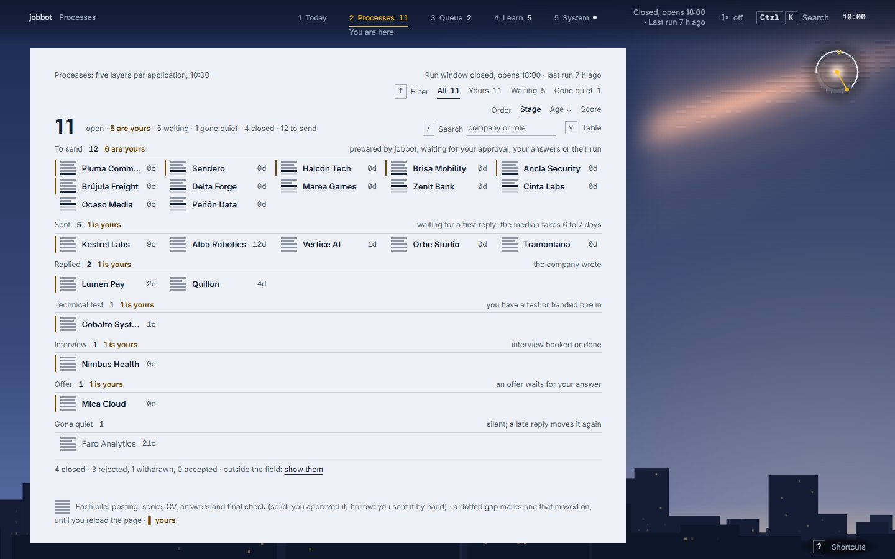

# jobbot

**Un asistente de búsqueda de empleo que nunca dice algo que no le hayas dicho que diga, y nunca
envía algo que no puedas detener.** Lee tableros públicos de empleo, puntúa los avisos, adapta un
CV, llena los formularios de postulación en un navegador real y guarda el registro de cada
postulación. Lo que no puede responder con la verdad vuelve a la persona. Escrito en Rust; corre
en un PC, para una persona.


**Para verlo en movimiento:** [The Night Shift](https://gonzalo-rosas-rojas.github.io/jobbot-showcase/?lang=es)
recorre una noche de jobbot con datos ficticios y termina en una demo en vivo de este panel
([código](https://github.com/gonzalo-rosas-rojas/jobbot-showcase)).

[Read in English](README.md)

> **Estado.** Una herramienta personal, hecha para mi propia búsqueda de empleo y publicada para
> que se pueda leer su ingeniería. No es un producto ni un servicio. El perfil y el CV de este
> repositorio (`profile/`, `cv/` y los mismos archivos en `examples/`) describen a una persona
> inventada.

## Qué hace

```text
descubrir ->  preparar  ->  enviar   ->  seguir
 tableros      CV a la      prueba en    bandeja, tareas,
 + filtros     medida       seco, con    dossiers, repaso
 + puntaje     + PDF        ayuda o real
```

- **Descubrir**: lee tableros de Greenhouse, Lever, Ashby, SmartRecruiters, Workable y Recruitee y
  una docena de fuentes de empleo remoto, quita duplicados, empresas excluidas y cargos que no se
  pueden hacer desde donde vive la persona, puntúa el resto contra `profile/criteria.toml` y deja
  una cola ordenada en SQLite.
- **Preparar**: adapta el CV maestro a cada aviso: reordena habilidades que el CV ya tiene y agrega
  una frase. No interviene ningún modelo de lenguaje y no se agrega nada que la persona no haya
  escrito. Chromium imprime el PDF.
- **Enviar**: llena cada formulario desde un banco de respuestas. Por defecto es una **prueba en
  seco**: llena lo que sabe, guarda una captura y no envía nada. `--assist` llena un navegador
  visible y deja el clic a la persona. `--live` envía solo lo que pasó la compuerta, y da la
  postulación por enviada solo cuando la página lo confirma.
- **Seguir**: los correos, resumidos en otra parte, se importan desde un archivo y mueven cada
  postulación por su máquina de estados; Claude escribe un dossier de entrevista cuando una empresa
  responde; un repaso espaciado cubre las preguntas que el dossier encontró débiles.
- **El panel** es una página web local para todo eso: lo que necesita a la persona hoy, la cola
  con la razón de cada puntaje, cada postulación con su historia y el estado del motor.

## Las reglas que sostiene

Son las partes que yo querría que un revisor comprobara. Cada una es una guardia en el código con
una prueba detrás; [`SECURITY.md`](SECURITY.md) las lista como afirmación, archivo y prueba, y una
prueba falla cuando esa tabla nombra una prueba que ya no existe.

- **Lo que no se sabe queda en blanco, nunca inventado.** Una pregunta que el banco de respuestas
  no cubre (un "¿por qué nosotros?", una pregunta legal, la autoidentificación que la persona se
  reservó) queda vacía y marcada. `--live` no hace clic en enviar mientras falte una respuesta
  obligatoria.
- **Nada se envía dos veces, y nada queda como enviado sin haberlo sido.** Antes de cada clic queda
  escrita una intención. Un clic cuyo resultado nadie vio cuenta como intentado y pasa a la
  persona; el programa no vuelve a hacerlo.
- **Una sola compuerta antes de cada envío.** El archivo `STOP`, las plataformas que prohíben bots,
  la lista de exclusiones, los avisos viejos, el tope diario, un descanso por empresa y la
  aprobación manual de las primeras postulaciones se revisan en un solo lugar, y solo ese lugar
  puede crear el permiso que un envío real exige: enviar sin él no compila.
- **El texto de desconocidos es dato.** Avisos, páginas de postulación y correos se limpian y se
  cortan; llegan al modelo como cadenas JSON, y el modelo corre sin herramientas, en una carpeta
  vacía y dentro de un presupuesto diario.
- **Al navegador no se lo puede mandar adonde no debe ir.** Los enlaces son solo https, sin
  credenciales y sin direcciones locales o privadas, se escriban como se escriban; se revisan antes
  de que el navegador se mueva y otra vez donde aterriza, y un proxy de salida mantiene toda
  petición de la página fuera de la red de la casa.
- **El panel responde solo a su propia página.** `127.0.0.1`, `Host` exacto, un token por
  lanzamiento, ningún `Origin` ajeno, POST solo con JSON, y una Content-Security-Policy con nonce y
  trusted types.
- **No resuelve CAPTCHA ni automatiza donde un sitio lo prohíbe.** Esas postulaciones se llenan
  para que la persona las revise y las envíe a mano.

El modelo de amenazas completo, con lo que queda sin resolver, está en
[`docs/engineering/threat-model.md`](docs/engineering/threat-model.md).

## Cómo está hecho

Un workspace de Cargo en capas: un dominio puro, los casos de uso con los puertos que necesitan, un
crate por adaptador y una línea de comandos delgada. Las capas son una prueba, no una costumbre:
`tests/architecture.rs` lee `cargo metadata` y hace fallar la compilación si un crate depende de
uno que no debe.

| capa | crate | contiene |
|---|---|---|
| 0 | `jobbot-domain` | las reglas, sin entrada ni salida: puntaje, exclusión, la máquina de estados de una postulación, la política de navegación, el planificador de formularios, el banco de respuestas |
| 1 | `jobbot-app` | los casos de uso (descubrimiento, el envío y su compuerta, la bandeja, los dossiers) y los puertos que necesitan |
| 2 | `jobbot-store`, `jobbot-sources`, `jobbot-claude`, `jobbot-browser`, `jobbot-panel` | un adaptador cada uno: SQLite, los tableros por HTTP, `claude -p`, Chromium, el panel local |
| 3 | `jobbot-testkit` | solo apoyo de pruebas: datos de prueba, un Claude falso, el corpus hostil, el arnés de rendimiento |
| 4 | `jobbot` | la línea de comandos: conecta los adaptadores con los casos de uso |

Los adaptadores nunca dependen entre sí, de modo que la base de datos no puede llamar a un tablero
ni el navegador al modelo: todo camino entre dos de ellos pasa por la aplicación.

- [`ARCHITECTURE.md`](ARCHITECTURE.md): los crates, los puertos, una corrida paso a paso, dónde
  vive el estado.
- [`docs/adr/`](docs/adr/README.md): trece decisiones y lo que cuesta cada una.
- [`panel-src/`](panel-src/README.md): el front del panel, módulos ES sin framework con sus propias
  pruebas y guardias; la página que el binario incrusta se construye desde ahí, y una prueba falla
  cuando las dos difieren.
- [`AI-USE.md`](AI-USE.md): cómo se usó la IA para construirlo, y la forma acotada en que el
  programa la usa.

(Esos documentos están en inglés.)

## El panel

`jobbot panel` sirve una página web local, solo en `127.0.0.1`. Las capturas de esta página son su
modo de demostración, que corre con datos inventados y no envía nada; las toma
`scripts/readme-shots.mjs`, y [The Night Shift](https://gonzalo-rosas-rojas.github.io/jobbot-showcase/?lang=es)
deja usar esa misma demo.

**La cola**: qué sale después, por qué tiene el puntaje que tiene, y la captura de la prueba en seco de su formulario.


**Cada postulación, por etapa**, con las que necesitan a la persona marcadas.



**La sala de máquinas**: la última corrida paso a paso, las fuentes, los errores y el gasto en el modelo.


## Probarlo

Rust 1.95 (fijado en `rust-toolchain.toml`). La herramienta corre a diario en Windows; la
integración continua la compila y corre sus pruebas en Windows y, a modo informativo, en Linux.

```sh
cargo build --release
cargo test --workspace --locked              # sin red ni navegador
target/release/jobbot install-browsers       # descarga Chromium una vez
target/release/jobbot discover               # lee los tableros de profile/sources.toml
target/release/jobbot top --n 20             # los avisos con mejor puntaje
target/release/jobbot submit                 # prueba en seco: llena los formularios, guarda capturas, no envía nada
target/release/jobbot panel                  # el panel local
```

`jobbot stop` crea el archivo `STOP`, que detiene todo comando que podría enviar; `jobbot resume`
lo quita. Antes de usarlo con avisos reales, reemplaza `profile/` y `cv/` por los tuyos y lee
`profile/answers.toml` línea por línea: son las afirmaciones que el programa hará en tu nombre.
`JOBBOT_HOME` mueve todo el estado privado a otra carpeta.

## Comprobaciones

| comando | qué revisa |
|---|---|
| `scripts/check.ps1` | formato, clippy con las advertencias como errores, las pruebas, `cargo deny` y `cargo audit` |
| `cd panel-src && npm ci && npm run check` | la página del panel: la construye, revisa sus capas y presupuestos, busca caracteres de control bidireccionales en las fuentes, corre las pruebas que no necesitan navegador y comprueba que la página incrustada en el binario es la que sale de las fuentes |
| `cargo run -- install-browsers`, y luego `cargo test --workspace --locked -- --ignored --test-threads=1 --skip real_claude_answers_through_the_runner --skip the_real_scheduler_answers_within_the_deadline` | las pruebas que abren Chromium (las dos omitidas piden un `claude` con sesión iniciada y el Programador de tareas de Windows) |
| `cargo bench --bench budgets` | los presupuestos de rendimiento sobre un conjunto de datos sintético |
| `cargo mutants -p jobbot-domain` | cuántas fallas sembradas a propósito en el dominio detectan las pruebas ([`docs/engineering/mutation-testing.md`](docs/engineering/mutation-testing.md)) |
| `cargo +nightly fuzz run <objetivo>` | el planificador de formularios, la importación de correos, los enlaces y la página del CV, en Linux ([`fuzz/README.md`](fuzz/README.md)) |

Más de 1.400 pruebas de Rust corren sin red con un `cargo test`, y unas 130 más abren Chromium. El
panel tiene más de 850 pruebas que no necesitan navegador y unas 440 que manejan un Chrome real
(`npm run check:full` en `panel-src/`).

La integración continua ([`.github/workflows/ci.yml`](.github/workflows/ci.yml)) corre formato,
clippy y las pruebas en Windows (Linux a modo informativo), las comprobaciones del panel en Linux, y
`cargo deny` y `cargo audit` en cada push y pull request y otra vez cada lunes. Las pruebas con
Chromium corren en Windows a mano y cada lunes. Dependabot abre cada semana un pull request con las
actualizaciones de GitHub Actions, Cargo y npm.

Para contribuir: [`CONTRIBUTING.md`](CONTRIBUTING.md).

## Límites, sin adornos

- Windows primero. Los scripts del programador de tareas son PowerShell; el job de Linux en la
  integración continua es informativo.
- La línea de comandos, el resumen diario y las preguntas de entrevista están en español, mi
  lengua materna. El panel está en español e inglés; el código, sus comentarios y estos documentos,
  en inglés. El estado que toma una postulación cuando necesita a la persona se llama
  `needs_gonza`: la herramienta se hizo para una persona, y se nota.
- Las horas se muestran en hora de Santiago de Chile; solo las horas ocupadas de
  `profile/schedule.toml` aceptan otra zona.
- Un solo llenador genérico atiende los formularios de las páginas propias de los tableros
  (Greenhouse, Lever y similares). Ashby marca un navegador automatizado aunque el clic lo haga una
  persona, así que esos formularios se ensayan en seco y pasan a la persona, que los envía en su
  propio navegador. Los avisos de fuentes que solo listan un empleo (Remotive, Hacker News, la
  búsqueda de Workable y otras) se abren a mano.
- La primera compilación descarga el controlador de Playwright al caché del usuario sin suma de
  verificación; `scripts/verify-playwright-driver.ps1` lo revisa después.
- Lo que el modelo de amenazas deja abierto está escrito en su última sección, no aquí.

## Licencia

[MIT](LICENSE), salvo las fuentes, el código y los iconos de terceros que lista
[`THIRD_PARTY_NOTICES.md`](THIRD_PARTY_NOTICES.md), que conservan sus propias licencias (las fuentes: SIL Open Font
License 1.1, textos en `panel-src/assets/fonts/licenses/`).
