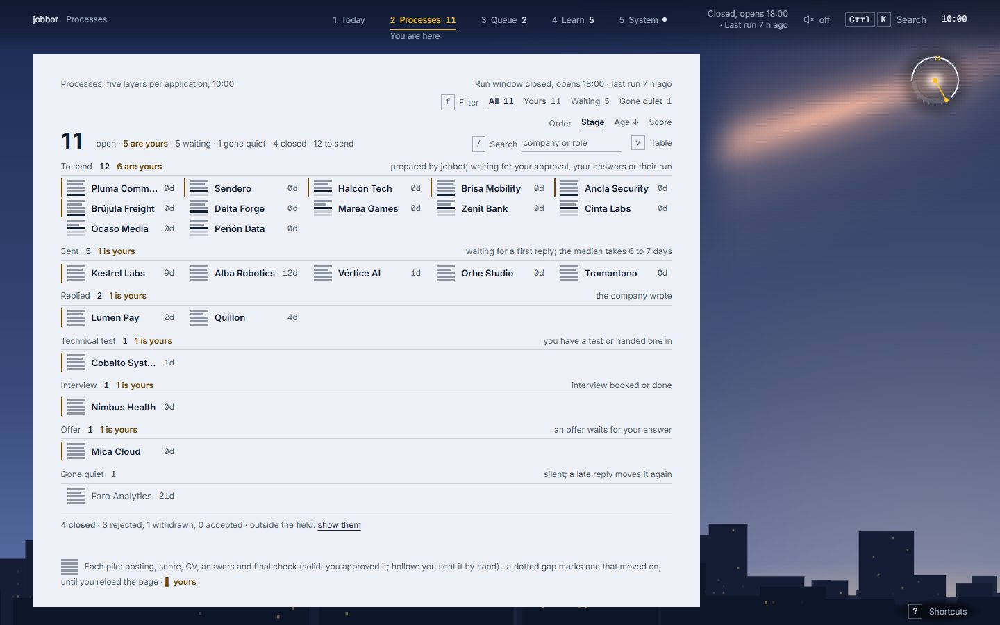
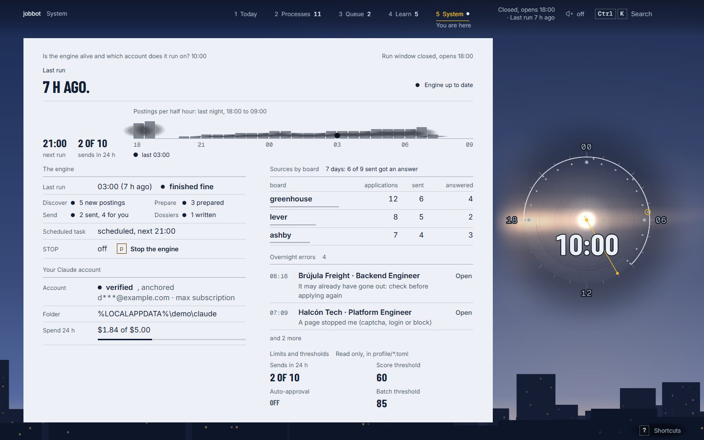

# jobbot

[](https://github.com/gonzalo-rosas-rojas/jobbot/actions/workflows/ci.yml)

**A job-search assistant that never says anything you have not told it to say, and never sends
anything you cannot stop.** It reads public job boards, scores the postings, tailors a CV, fills
the application forms in a real browser and keeps the record of every application. Whatever it
cannot answer honestly goes back to the person. Written in Rust; runs on one PC, for one person.


**See it move:** [The Night Shift](https://gonzalo-rosas-rojas.github.io/jobbot-showcase/) walks
through one night of jobbot on fictional data and ends in a live demo of this panel
([source](https://github.com/gonzalo-rosas-rojas/jobbot-showcase)).

[Leer en español](README.es.md)

> **Status.** A personal tool, built for my own job search and published so the engineering can be
> read. It is not a product or a service. The profile and CV in this repository (`profile/`, `cv/`
> and the same files in `examples/`) describe a fictional candidate.

## What it does

```text
discover  ->  prepare  ->  submit  ->  follow up
 boards       tailored     dry run,     inbox, tasks,
 + filters    CV + PDF     assisted     dossiers, drills
 + scoring                 or live
```

- **Discover** reads Greenhouse, Lever, Ashby, SmartRecruiters, Workable and Recruitee boards and a
  dozen remote-job feeds, drops duplicates, excluded companies and roles that cannot be done from
  where the candidate lives, scores the rest against `profile/criteria.toml` and keeps a ranked
  queue in SQLite.
- **Prepare** tailors the CV master to each posting: it reorders skills the CV already lists and
  adds one sentence. No language model is involved and nothing is added that the person did not
  write. Chromium prints the PDF.
- **Submit** fills each form from an answer bank. The default is a **dry run**: it fills what it
  knows, saves a screenshot and sends nothing. `--assist` fills a visible browser and leaves the
  click to the person. `--live` sends only what passed the gate, and records the application as
  sent only when the page confirms it.
- **Follow up**: e-mails summarised elsewhere are imported from a file and move each application
  along its state machine; Claude writes an interview dossier when a company answers; a
  spaced-repetition drill covers the questions the dossier found weak.
- **The panel** is a local web page for all of it: what needs the person today, the queue with the
  reason for every score, every application and its history, and the state of the engine.

## The rules it holds

These are the parts I would want a reviewer to check. Each one is a guard in the code with a test
behind it; [`SECURITY.md`](SECURITY.md) lists them as claim, file and test, and a test fails when
that table names a test that no longer exists.

- **Unknown means blank, never invented.** A question the answer bank does not cover (an open "why
  us?", a legal question, self-identification the person kept for themselves) is left empty and
  flagged. `--live` does not click submit while a required answer is missing.
- **Nothing is sent twice, and nothing is marked sent that was not.** An intent is written before
  every click. A click whose outcome nobody saw is counted as attempted and handed to the person;
  the program never clicks it again.
- **One gate before every send.** The `STOP` file, platforms that forbid bots, the exclusion list,
  stale postings, the daily cap, a per-company cooldown and manual approval of the first
  applications are checked in one place, and only that place can make the token a live send
  requires: sending without it does not compile.
- **Strangers' text is data.** Postings, apply pages and e-mails are cleaned and cut; they reach
  the model as JSON strings, and the model runs with no tools, in an empty directory, inside a
  daily budget.
- **The browser cannot be sent somewhere it should not go.** Links are https only, with no
  credentials and no local or private address however it is spelled, checked before the browser
  moves and again where it lands; an egress proxy keeps every page request off the home network.
- **The panel answers only its own page.** `127.0.0.1`, exact `Host`, a token per launch, no
  foreign `Origin`, JSON-only POSTs, a nonce-only Content-Security-Policy with trusted types.
- **No CAPTCHA solving, no automation where a site forbids it.** Those applications are filled for
  the person to review and send by hand.

The full threat model, with what is left unsolved, is in
[`docs/engineering/threat-model.md`](docs/engineering/threat-model.md).

## How it is built

A Cargo workspace in layers: a pure domain, the use cases with the ports they need, one crate per
adapter and a thin command line. The layering is a test, not a convention:
`tests/architecture.rs` reads `cargo metadata` and fails the build when a crate depends on one it
must not.

| layer | crate | holds |
|---|---|---|
| 0 | `jobbot-domain` | the rules, with no I/O: scoring, exclusion, the application state machine, the navigation policy, the form planner, the answer bank |
| 1 | `jobbot-app` | the use cases (discovery, the apply pipeline and its gate, inbox, dossiers) and the ports they need |
| 2 | `jobbot-store`, `jobbot-sources`, `jobbot-claude`, `jobbot-browser`, `jobbot-panel` | one adapter each: SQLite, the job boards over HTTP, `claude -p`, Chromium, the local panel |
| 3 | `jobbot-testkit` | test support only: fixtures, a fake Claude, the hostile corpus, the benchmark harness |
| 4 | `jobbot` | the command line: wires the adapters to the use cases |

Adapters never depend on each other, so the database cannot call a job board and the browser cannot
call the model: every path between two of them goes through the application.

- [`ARCHITECTURE.md`](ARCHITECTURE.md): the crates, the ports, a run step by step, where state lives.
- [`docs/adr/`](docs/adr/README.md): thirteen decisions and what each one costs.
- [`panel-src/`](panel-src/README.md): the panel's front end, plain ES modules with its own tests
  and guards; the page the binary embeds is built from it, and a test fails when the two differ.
- [`AI-USE.md`](AI-USE.md): how AI was used to build it, and the narrow way the program uses it.

## The panel

`jobbot panel` serves a local web page, on `127.0.0.1` only. The screenshots here and above are its
demo mode, which runs on made-up data and sends nothing; `scripts/readme-shots.mjs` takes them, and
[The Night Shift](https://gonzalo-rosas-rojas.github.io/jobbot-showcase/) lets you use that same demo.

**The queue**: what goes out next, why it scored what it did, and the practice-run capture of its form.


**Every application, by stage**, with the ones that need the person marked.



**The engine room**: the last run step by step, the sources, the errors, the spend on the model.



## Try it

Rust 1.95 (pinned in `rust-toolchain.toml`). The tool is run daily on Windows; CI builds it on
Windows and, as information, on Linux.

```sh
cargo build --release
cargo test --workspace --locked              # no network, no browser
target/release/jobbot install-browsers       # downloads Chromium once
target/release/jobbot discover               # reads the boards in profile/sources.toml
target/release/jobbot top --n 20             # the best-scored postings
target/release/jobbot submit                 # dry run: fills the forms, saves screenshots, sends nothing
target/release/jobbot panel                  # the local panel
```

`jobbot stop` creates the `STOP` file that halts every command that could send; `jobbot resume`
removes it. Before pointing it at real postings, replace `profile/` and `cv/` with your own and
read `profile/answers.toml` line by line: those are the statements the program will make on your
behalf. `JOBBOT_HOME` moves all private state to another folder.

## Checks

| command | what it checks |
|---|---|
| `scripts/check.ps1` | formatting, clippy with warnings as errors, the tests, `cargo deny` and `cargo audit` |
| `cd panel-src && npm ci && npm run check` | the panel page: builds it, checks its layers and budgets, scans the sources for bidirectional control characters, runs the tests that need no browser, and confirms that the page embedded in the binary is the one the sources build |
| `cargo run -- install-browsers`, then `cargo test --workspace --locked -- --ignored --test-threads=1 --skip real_claude_answers_through_the_runner --skip the_real_scheduler_answers_within_the_deadline` | the tests that start Chromium (the two skipped ones need a logged-in `claude` and the Windows Task Scheduler) |
| `cargo bench --bench budgets` | the performance budgets on a synthetic data set |
| `cargo mutants -p jobbot-domain` | how many deliberate faults in the domain the tests catch ([`docs/engineering/mutation-testing.md`](docs/engineering/mutation-testing.md)) |
| `cargo +nightly fuzz run <target>` | the form planner, the e-mail import, links and the CV page, on Linux ([`fuzz/README.md`](fuzz/README.md)) |

More than 1,400 Rust tests run offline with a plain `cargo test`, and about 130 more start Chromium.
The panel has more than 850 tests that need no browser and about 440 that drive a real Chrome
(`npm run check:full` in `panel-src/`).

CI ([`.github/workflows/ci.yml`](.github/workflows/ci.yml)) runs formatting, clippy and the tests
on Windows (Linux as information), the panel checks on Linux, and `cargo deny` and `cargo audit` on
every push and pull request and again every Monday. The Chromium tests run on Windows by hand and
every Monday. Dependabot alerts are on, and a vulnerable crate, package or action gets a pull
request; routine version updates are made in the development tree and arrive with the next release.

Contributions: see [`CONTRIBUTING.md`](CONTRIBUTING.md).

## Limits, honestly

- Windows first. The scheduler scripts are PowerShell; the Linux CI job is informative.
- The command line, the daily digest and the interview questions are in Spanish, my native
  language. The panel is in Spanish and English; the code, its comments and these documents are in
  English. The state an application takes when it needs the person is called `needs_gonza`: the
  tool was built for one person, and it shows.
- Times are shown in Santiago (Chile) time; only the busy hours in `profile/schedule.toml` take
  another zone.
- One generic filler handles the forms on the boards' own pages (Greenhouse, Lever and the like).
  Ashby flags an automated browser even when a person clicks, so those forms are rehearsed in a
  dry run and handed to the person to send in their own browser. Postings from sources that only
  list a job (Remotive, Hacker News, Workable's search and others) are opened by hand.
- The first build downloads the Playwright driver into the user cache without a checksum;
  `scripts/verify-playwright-driver.ps1` checks it afterwards.
- What the threat model leaves open is written down in its last section, not here.

## License

[MIT](LICENSE), except the third-party fonts, code and icons listed in
[`THIRD_PARTY_NOTICES.md`](THIRD_PARTY_NOTICES.md), which keep their own licences (the fonts: SIL Open Font
License 1.1, texts in `panel-src/assets/fonts/licenses/`).
